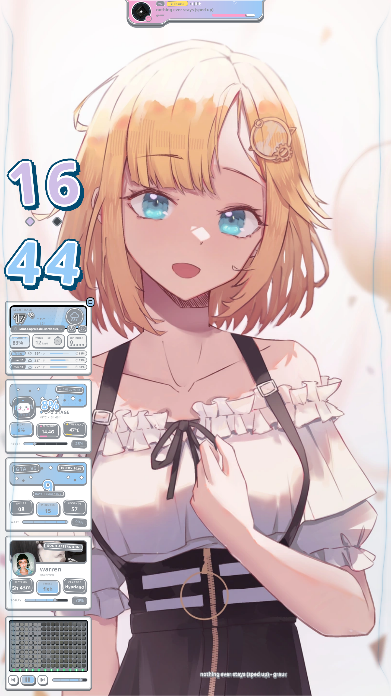

# Sekai Notch 🌸

> *"A tiny capsule that unfolds into a whole desktop control room. Like a magic origami, but for your power button."*

A native **Quickshell / QML** system notch for the **portrait secondary monitor**, built to feel like a true screen-edge notch — one continuous shape, one coherent animation, zero popups. It belongs to the **Sekai Pop** visual family without being just another widget tile.

Works with **any Quickshell setup** (no Ryoku dependency).

---

## ✨ Features

- 🌸 **Collapsed capsule** — a discreet little pill hugging the top edge of your portrait screen.
- 🪄 **Hover to unfold** — move your cursor to the top-center and watch the notch *organically* melt downward into a full control panel. One shape, one motion, no separate popup.
- 🎛️ **System actions** — Lock, Suspend, Restart, Shutdown (real `loginctl`/`systemctl`). Restart & Shutdown require confirmation.
- 🎵 **Music page** — album art, track info, live visualizer, transport controls, seek bar.
- 🌤️ **Weather page** — live weather (Open-Meteo / wttr.in) with forecast.
- 🧊 **Workspaces, Clock, Stats, Clipboard** pages.
- 🎚️ **Customize drawer** — geometry, 2.5D depth, scale, colors, action pool with drag-and-drop.
- 🌀 **2.5D parallax** — buttons and inner elements tilt with the cursor. The notch itself stays still.
- 🌀 **Smooth morphing** — page switches slide & fade.
- ⏱️ **Auto-close** — ~700 ms after mouse exit.
- 🎯 **Portrait-monitor only** — targets the leftmost portrait display automatically.
- 🪶 **Lightweight when idle**.

## 📸 Preview

| Collapsed | Expanded (Actions) |
|---|---|
|  |  |

| Music | Weather |
|---|---|
|  |  |

| Workspaces | Clock |
|---|---|
|  |  |

| Stats | Clipboard |
|---|---|
|  |  |

| Customize drawer |
|---|
|  |

## 🚀 Install

```bash
git clone https://github.com/lachaise97420/sekai-notch.git
cd sekai-notch
bash install.sh
qs -c sekai-notch
```

## 🛠️ Tech

- Native **Quickshell** + **QML**.
- Reuses **Sekai Pop** design tokens (embedded, no Ryoku dependency).
- Layer-shell overlay, top-center, transparent activation zone, proper input mask.

## ⚠️ Disclaimer

No notch was harmed in the making of this widget. The 2.5D button is a toggle, not a snack. Please do not feed after midnight. 🌙

---

Made with 💜 and a suspicious amount of QML.